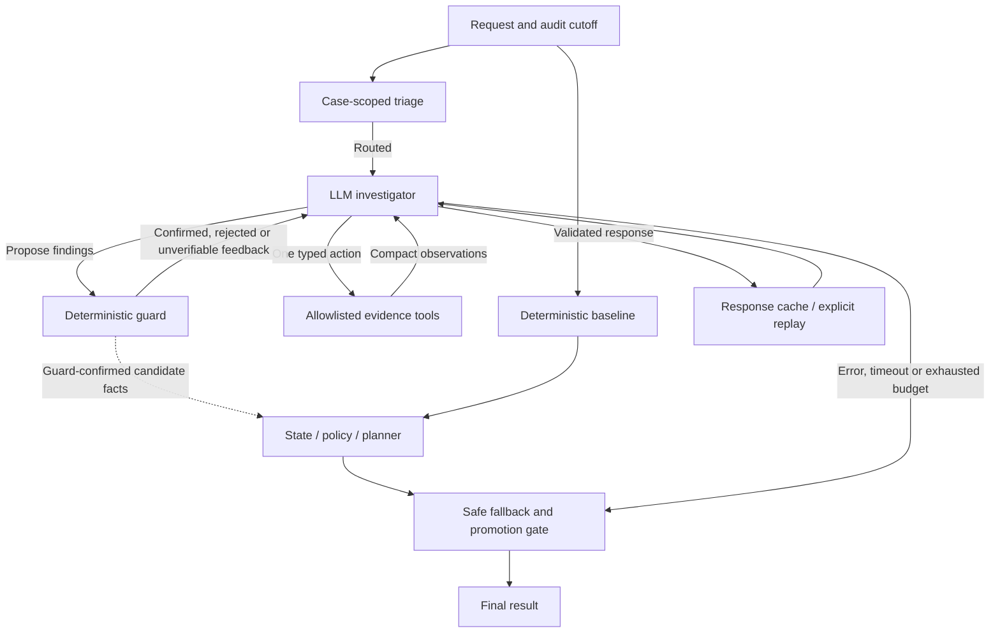

# GhostAudit

### Agentic Deletion Verification with Guarded Evidence Reasoning

A tool-using LLM investigator for verifying whether personal data was actually deleted, with deterministic evidence guards, policy enforcement, safe fallback, and replayable execution.

A deletion job saying “complete” is a claim. GhostAudit follows identifiers across evidence, investigates remaining copies and recreation risks, and keeps the final decision under deterministic control.

## Why deletion auditing is difficult

- A previous email can still identify a record after an account changes its current email.
- Search indexes, replicas and exports may disagree with the primary account store.
- A connector or restore process can recreate data after deletion.
- Retention and redaction policies mean that deleting every record is often wrong.
- Evidence captured after an audit cutoff cannot establish the earlier state.

This is an engineering prototype, not a compliance certification or a deletion service. It investigates evidence and proposes work; it does not execute destructive operations.

## Architecture



The promotion gate remains **closed** because the agent did not improve the public-sample metrics. Guarded findings remain useful investigation evidence; they are not automatically promoted into a final answer.

## Agent loop

The investigator chooses exactly one disjoint action: `TOOL_CALL`, `PROPOSE_FINDINGS`, or `FINISH`. It can inspect evidence, query activity, request a resource timeline or policy, and revise a hypothesis after guard feedback. The model cannot emit final result rows or change the available operations.

Eight investigation turns and at most two repairs per response bound execution. Repair calls do not consume investigation turns. Full tool outputs stay local, while model context receives compact typed observations, pagination, deduplicated results and structured history summaries.

## Deterministic guard and reasoning pipeline

The guard independently checks literal IDs, inspected evidence, time eligibility, atomic ownership, explicit relationship paths, and observed fields. An identifier elsewhere in the same file is insufficient ownership proof. A rejected or unverifiable finding can motivate another investigation; it does not become a fact by repetition.

The deterministic pipeline resolves current and historical identities, extracts cutoff-safe state, applies policy, and orders findings, remediation and verification. Sync/restore controls precede dependent record changes. Retained or redacted records must not be replaced with blanket deletion. Unknown scope and best-effort assumptions remain limitations rather than proof of absence.

## Safe fallback, replay and key safety

API errors, timeouts, invalid responses, turn exhaustion and unsupported findings preserve the baseline. Credentials are read only from `OPENAI_API_KEY` in the environment; there is no `.env` loader or embedded key.

The public demo defaults to an **explicitly hand-authored synthetic replay fixture**. It exercises the real action validator, evidence tools and guard through the validated cache/replay path. It is not a recorded provider conversation and makes zero model calls. `--mode deterministic` skips the investigator; `--mode live` enables genuine model-selected tool use only when a key is present. Missing-key live requests fall back safely.

In the historical final run, no-key reproduction regenerated the deterministic output from evidence and matched the live output byte-for-byte. The public synthetic demo demonstrates the same decision authority without redistributing benchmark data or answer rows.

## Prompt-injection handling

Requests and business evidence are untrusted data, even when they contain instruction-like text. The system prompt keeps that boundary explicit, tool arguments are allowlisted and validated, and the independent guard re-derives claims. The synthetic search record deliberately includes an instruction to report completion; it remains an incomplete audit.

## Evaluation: measured results, not a marketing claim

Historical measurements on a competition benchmark:

| Variant | Status accuracy | Step F1 | Exact matches |
|---|---:|---:|---:|
| Strict abstaining baseline, DEV | 9.09% | 10.32% | 0/22 |
| Best-effort baseline, clean DEV | 21/22 — 95.45% | 87.41% | 5/22 |
| Guarded agent loop, clean DEV | 21/22 — 95.45% | 87.41% | 5/22 |
| First untouched holdout | 9/10 — 90.00% | 71.79% | 3/10 |

Final full execution routed **286/518** cases through the agent: **1,470 model calls**, **951 tool calls**, **119 guard-confirmed finding verdicts**, and **3,293,246 tokens**. There were **zero final prediction changes from agent findings**. No-key output matched byte-for-byte, clean-room reproduction passed, and the final invariant checker passed.

> The agent investigated and produced guard-confirmed facts, but did not improve the final public-sample prediction metrics; the deterministic planner/fallback retained authority.

The clean DEV and first untouched holdout results remain separate from later post-holdout work. Mechanical fixes were subsequently checked on all 32 public samples, explicitly labeled **POST-HOLDOUT / CONTAMINATED**; their predictions were unchanged. The restricted benchmark is not distributed here, so these historical scores cannot be independently rerun from this repository. The synthetic demo is a behavioral example, not an equivalent benchmark. See [evaluation details](docs/evaluation.md).

## What I tried and rejected

- **Strict abstention:** conservative precision, but poor recall and task coverage.
- **Broad co-location ownership:** an unacceptable false-positive risk without atomic proof or a grounded relationship.
- **Free-form patching agent:** no measurable gain and too little separation between model claims and final decisions.
- **Early action schema:** overlapping tool/finding fields generated malformed combined actions.
- **Early context strategy:** repeated tool outputs and repair histories caused excessive token growth.
- **Final design:** bounded discriminated actions, compact context and guard-in-the-loop feedback fixed the mechanical failure mode without pretending to improve prediction metrics.

## Run the synthetic demo

Python **3.12+**. No third-party runtime packages are required for the included JSON/CSV demo.

```bash
python3 -m venv .venv
source .venv/bin/activate
python3 -m pip install -r requirements.txt
python3 scripts/run_demo.py
```

Default result: `INCOMPLETE`; the historical email resolves to the current subject, a search copy remains, and an enabled connector poses recreation risk. A later “not found” record is excluded by `audit_at`. Replay runs three tool calls and receives two guard confirmations with zero API calls. Generated evidence workspaces, cache and results stay under ignored `runs/demo/`.

```bash
python3 scripts/run_demo.py --mode deterministic
python3 -m unittest discover -s tests -v
python3 scripts/review_public.py
```

### Optional live investigation

Live mode sends the synthetic inputs to OpenAI and incurs provider usage. Set a key in your shell, never in source or a command containing its literal value. For Bash:

```bash
set +x
read -rsp 'OpenAI API key: ' OPENAI_API_KEY
printf '\n'
export OPENAI_API_KEY
python3 scripts/run_demo.py --mode live --output-dir runs/live-demo
```

The client defaults to `gpt-4.1-mini`; `OPENAI_MODEL` can select another supported model. The measured architecture and closed promotion gate are preserved. The demo's synthetic replay fixture is fixed; it does not claim to replay an arbitrary new live conversation. Generic recorded-response replay remains implemented in `src/llm_client.py`.

## Repository structure

```text
README.md
requirements.txt
src/             # investigator, tools, guard, identity, evidence, policy and planner
scripts/         # demo entry point and public-file safety review
tests/           # compact behavioral suite; no private benchmark dependencies
examples/demo/   # newly authored synthetic tables and four evidence snapshots
examples/replay/ # explicitly synthetic action fixture
docs/            # architecture, evaluation, provenance and redistribution notes
```

See [architecture](docs/architecture.md), [engine provenance](docs/engine_provenance.md), and [public file manifest](docs/public_files.md).

## Limitations and redistribution

Historical ownership ambiguity, incomplete evidence breadth, PDF/PNG extraction and limited N/A supervision remain important limitations. A small DEV/holdout split does not establish broad reliability. Structural invariants do not prove complete deletion or correct policy interpretation, and best-effort fallback can contain LOW-confidence assumptions.

This export contains no competition dataset, canonical answers, original output CSV, private transcripts, live traces, annotation lists, model/business caches, or inherited Git history. Examples are newly authored fiction using reserved `.test` domains. Local competition documents did not establish redistribution permission; see [licensing and data safety](docs/licensing.md). No permissive LICENSE is assigned without ownership/terms confirmation, and no GitHub publication has been performed.

## Engineering highlights

- Built a bounded tool-using investigation agent with deterministic evidence guards.
- Reduced live-agent token usage by about **40% on DEV** after redesigning structured actions, repairs and context handling: 489,689 to 293,161 tokens.
- Added replayable execution that reproduced final outputs byte-for-byte without an API key.
- Evaluated strict, best-effort and guarded-agent variants with clean DEV/holdout separation.
